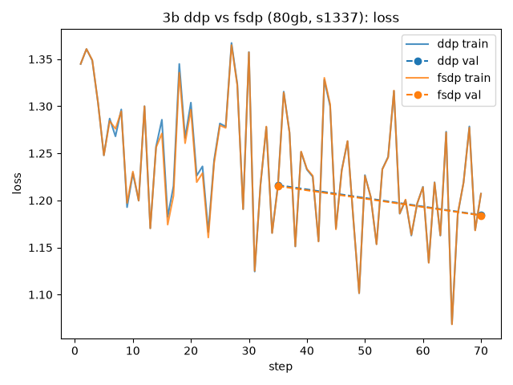
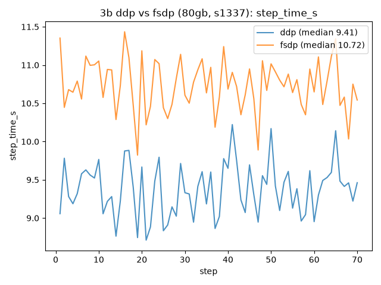
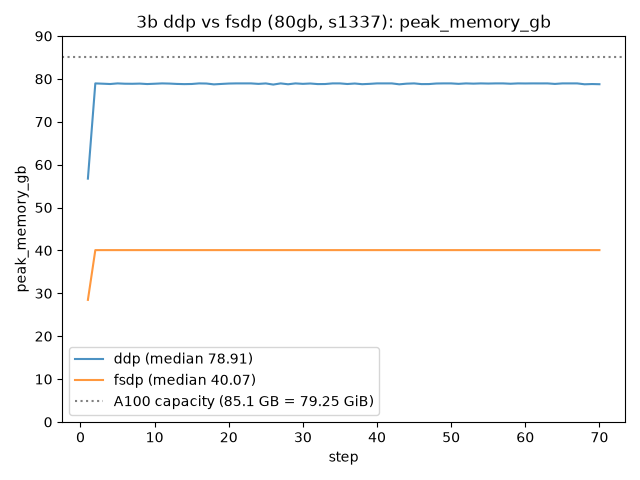

# DDP vs FSDP on 2x A100 80GB (3b, s1337)

runs: `3b_ddp_80gb_s1337` and `3b_fsdp_80gb_s1337` (vast 61285756, commit 57e1b89)

same yaml for both: Ministral 3B (3.43B trainable, fp32), micro batch 1, accumulation 32 (64 conversations per step), 70 steps, activation checkpointing on. DDP uses bf16 autocast, FSDP shards per decoder layer with bf16 params

both runs saw the exact same data every step

## Losses are the same

| | DDP | FSDP |
|---|---|---|
| val loss @ 35 | 1.2162 | 1.2152 |
| val loss @ 70 | 1.1844 | 1.1841 |

biggest per-step train loss gap is about 1%, just bf16 rounding in different places

## DDP is about 12% faster

median step: 9.41 s (DDP) vs 10.72 s (FSDP), so 12% less time per step. extrapolated to an epoch (~766 steps): about 2.0 h vs 2.3 h

why: DDP keeps a full copy of the weights on each gpu and only syncs gradients once per step. FSDP keeps half of each layer per gpu and has to fetch the other half before every forward and backward, so ~64 all-gathers per step at accumulation 32

## FSDP uses about half the memory

peak: 78.9 GB (DDP) vs 40.1 GB (FSDP), on an 85.1 GB card (79.25 GiB). DDP has ~6 GB left, FSDP ~45 GB

## FSDP fits about 6x the micro batch

the earlier FSDP runs without checkpointing went from 47.4 GB (micro batch 1) to 61.0 GB (micro batch 2). from that, one extra conversation costs ~6.3 GB with checkpointing on

1 + (78.9 - 40.1) / 6.3 = ~7 per micro batch, so 6x is about right (estimated, not tested). DDP can't even fit micro batch 2

## But not 5.3x faster

6x the micro batch x 0.88 speed = 5.3x assumes a step costs the same with 6 conversations as with 1. it doesn't:

- compute scales with tokens, and the gpu is already at ~35% of peak at micro batch 1, so the ceiling is under 3x
- batches get padded to the longest conversation: micro batch 6 computes ~1.57x more tokens than it learns from
- we tested it already: FSDP micro batch 2 was **13% slower** than micro batch 1 (10.31 vs 9.09 s per step, same data)

what bigger micro batches do buy: fewer all-gathers, so FSDP should get close to DDP, maybe 1-1.5x with length grouped batches. not 5x

## Better: turn off checkpointing

| steps 2-60 | step time | peak memory |
|---|---|---|
| DDP, checkpointing | 9.33 s | 78.9 GB |
| FSDP, checkpointing | 10.72 s | 40.1 GB |
| FSDP, no checkpointing | 9.09 s | 47.4 GB |

FSDP without checkpointing already beats DDP (different vast instance, same gpu, so worth re-running here)

## Takeaways

- same losses
- DDP ~12% faster at equal settings
- FSDP uses half the memory, room for ~6x the micro batch
- that's not 6x the speed, spend the memory on turning off checkpointing instead
